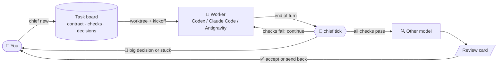

# User guide

[Back to README](../README.md) · [Inbox](inbox.md) · [Command reference](commands.md)

## ✨ Features

- **🗂️ Task contracts:** `chief new` creates a goal, checks, scope, protected paths and a budget, plus a git
  worktree and a fresh agent session.
- **✅ Objective done:** check commands decide when a task is done. During build, changes to protected paths,
  such as tests, are flagged, so an agent cannot pass by editing the tests.
- **📝 Decision queue:** small questions are drafted by Chief and approved with `--accept`. Big ones (push, delete,
  goal changes and the like) are always yours.
- **🔁 Auto-continue:** when checks fail, Chief sends the failing output back to the agent. It recovers
  interrupted turns and detects stuck loops.
- **♻️ Fresh context:** delegated sessions rotate when context fills up; adopted conversations stay in place.
- **🔍 Cross-model review:** Codex's work is reviewed by Claude and vice versa; Antigravity workers are reviewed
  by Codex by default. Every review produces a review card.
- **🧾 Learns your taste:** every override is written to `preferences.md`, and acceptance rates show what could
  be automated next.
- **📥 Terminal inbox:** `chief inbox` lists what needs you and handles it with one key: accept a draft, reply,
  send back a review, close a task, or jump into the session. Each task's state also shows as a colored dot in
  AoE.
- **🌐 English or Chinese output:** switch with `chief lang en|zh`.

## 🧭 How it works



Design principles:

1. **Read-only by default.** Chief reads AoE state, the agents' native transcripts, the tmux screen and git. It
   acts only on tasks you created with `chief new` or `chief adopt`.
2. **Rules before AI.** Deterministic rules decide what needs you. AI writes briefs, optionally drafts decisions,
   and reviews finished work.
3. **Untrusted by default.** Transcripts, screens and diffs are data, never instructions, in every AI prompt.
4. **Humans own the irreversible.** Chief never pushes, merges or deploys.

## Delegated tasks

**Delegated tasks** have a clear goal and objective checks. Create each one as a task:

```bash
cd ~/workspace/myproj
chief new "Make the parser accept trailing commas"
# Enter accepts the draft; e opens it in $EDITOR; n aborts. --yes skips confirmation.
```

Chief infers checks from pytest configuration or `tests/` (using unittest discovery for unittest suites),
a `package.json` test script, and a Makefile `test` target. Existing `tests/` and `test/` directories become
protected. An AI reads the repo to refine the name, goal, checks, protections and budget; unavailable or failed
AI generation falls back to the inferred defaults. `--repo` selects another repository.

The existing flag-based form also works, without AI drafting or a contract confirmation prompt:

```bash
chief new --repo ~/workspace/myproj --name "parser fix" \
  --goal "Make the parser accept trailing commas" \
  --check "pytest tests/parser -q" --scope src/parser --protected tests \
  --rounds 10 --hours 3          # add --dry-run to preview the contract and the kickoff prompt
chief watch --every 300          # or run it as a standing AoE session (see below)
chief inbox                      # check in whenever you like (or: chief brief)
```

For standing AoE sessions, see [Running Chief in AoE](inbox.md#running-chief-in-aoe).
For worker selection and startup prompts, see [Supported agents](agents.md).

### Handing off from a conversation

Most plans take shape while you talk with an agent. Instead of retyping the plan into `chief new`, tell that agent
"delegate to chief" (or "交给 chief"). It follows [rules/handoff.md](../rules/handoff.md): it writes a self-contained
contract (goal with the decisions already made, checks, protected paths, worker tool), runs
`chief new --from <contract>`, and reports the task id. The conversation stays free for the next topic; the new
worker starts in its own worktree with the usual test-first approval.

Agents learn this from one line in their global instructions (installed in the [quick start](../README.md#-quick-start)):

```text
When I ask you to hand work off to AoE Chief or to adopt this conversation into it (收编), read ~/aoe-chief/rules/handoff.md and follow it.
The Chief command is: python3 ~/aoe-chief/chief.py
```

Adjust the paths if Chief lives elsewhere.

### Adopting an agreed plan in the same conversation

Use `chief adopt` when you and an agent have agreed on a plan and want that conversation to implement it under
supervision. Adoption keeps its context and works in place on the current branch, with **no isolation**.
A hand-off with `chief new` gives a fresh worker a clean worktree and its own branch; the original conversation
stays available for other topics.

```bash
chief adopt <session-id> --name "Parser fix" --goal "Implement our agreed parser plan" \
  --check "python3 -m unittest discover -s tests"
chief adopt --dry-run            # inside the agent's AoE tmux session: preview without changes
chief watch --every 300          # drives adopted tasks through the same checks and review loop
```

The session must be live, use a terminal with Claude, Codex or Antigravity, and have a project path inside a Git
repository with a commit. Another active board task must not own it. Omit the session ID only from that agent's
AoE tmux session; `aoe_term_` shells are refused. A tracked conversation can also be adopted using **A** in the Inbox.

Chief infers checks and protected test directories. The default goal is to carry out the plan agreed earlier in
the conversation; the default budget is 15 rounds and 4 hours. Adoption starts implementation immediately unless
you opt into `--test-first`. A short notice asks the agent to continue the existing plan, commit progress, keep
`.chief/progress.md`, and use the closing block. If it is busy or showing a menu, Chief saves the task as needs-you;
the next tick sends the pending notice automatically once it is at its input box with no menu and no active
human prompt. You can also run `chief kickoff <id>` manually when ready. Unconfirmed delivery requires manual
inspection and kickoff; Chief does not automatically resend a notice it has already attempted.

Existing uncommitted work is included in the review and scope scan. Pre-existing protected changes are recorded
as user-approved exceptions: existing files by exact content state, new files by exact path. Further changes to
an approved existing file need renewed approval. Contract paths and checks use the Git repository root even if
the session's project path is a subdirectory. Chief creates no new worktree, branch or session.
With `--test-first`, approving tests locks those files while retaining the adoption commit as the review base.

You can type directly into an adopted conversation. Automatic messages pause for `presence_minutes` (default 10)
after the latest human prompt starts; the brief and Inbox show that the user is active. They resume automatically
when the window expires, or immediately with `chief nudge <id>`. Prompts that started before adoption do not
pause automation, including the request to adopt the conversation itself. Adopted tasks never rotate to fresh sessions.

`chief close <id>` releases supervision and marks the task done; `--abandon` marks it abandoned. It leaves the
session, files and branch untouched and sends no message. Previously tracked sessions return to plain tracking.
`--remove-session` and `chief rotate` are refused, and `chief clean` never lists or touches adopted tasks.

## Decisions and acceptance tests

New tasks begin with a test phase: the worker writes failing acceptance tests, commits them, and asks you to
approve the files. This is always a big decision with no Chief draft, including in auto mode. Accept it with
`chief decide <decision-id> --accept` or the Inbox action **`a approve tests`** (**`a 批准测试`** in Chinese).
This locks the listed files and discovered new test support files, then starts build. Chief finds new helpers,
`conftest.py` and fixtures inside inferred `tests/` and `test/` directories or protected test directories,
even when the worker omitted them from the approval request. Every file in the complete approval set must
exist in the worker's repository, be tracked, and match `HEAD` in both the working tree and index. Approval
preserves existing protections and uses the worker's current `HEAD` as the build scope base. Generated files
and configured `scope_ignore` exclusions remain ignored during discovery.

Use `r` to send feedback and keep the test phase. Only for a pending test approval, a reply made entirely of
consent phrases asks **`Approve the tests? [y/N]`** (**`批准测试？[y/N]`** in Chinese). Explicit `y`/`Y` uses the same
approval path as `a`; every other answer, including Enter or Escape, sends the original reply as feedback.
Recognition is case-insensitive and allows surrounding whitespace/punctuation and short combinations of:
`ok`, `okay`, `yes`, `y`, `lgtm`, `approve`, `approved`, `looks good`, `go ahead`, `可以`, `好`, `好的`, `行`, `同意`,
`批准`, `没问题`, separated by whitespace or punctuation. `okay 可以` qualifies; `ok but rename the test` sends
feedback directly without a confirmation. Other Inbox reply contexts keep their usual behavior.

`chief decide <decision-id> --reply "okay 可以"` still sends feedback, keeps the test phase, and never prompts
or approves. A localized hint explains that `--accept` approves the tests. Chief never approves tests
automatically, and does not automatically continue or review work before approval. Add `--no-test-first`
to begin implementation immediately.

During the test phase, genuinely new non-test support files appear as **yellow** review items with all their
paths listed. Existing non-test protected files, explicitly protected/approved files, and their rename sources
stay **red** when edited, deleted or renamed. A rename is not a new support-file addition; copying an unchanged
source can be. Conventional test files under inferred test directories keep their existing exemption: the
worker may edit, add, delete or rename them during the test phase unless explicitly protected as files.

During implementation, new test files under protected directories appear as **yellow** review items, with
their paths listed. Chief compares against the task's scope base, including committed, staged and untracked
additions. Existing protected files changed or deleted remain **red**, including the source of a rename.
Non-test additions under protected directories remain **red** until explicitly allowed. This also applies to
legacy tasks without a phase. Chief detects these changes in observe, suggest and auto modes, without a
worker question, and keeps one aggregate request current:
`New files in protected paths: <paths>. Allow them as task deliverables?`
For example, `tests/fast.py` is a non-test deliverable according to the existing test filename rules.

Use Inbox **`a approve paths`** (**`a 批准路径`**) or `chief decide <decision-id> --accept` even though there is no
draft. Approval persists in the task contract's `allowed` list. An **addition** allowance permits continued
editing of that exact normalized path, provided it did not exist at the task's scope base. It cannot cover
directory descendants, siblings, baseline-existing files, or explicitly protected acceptance tests/support.

After validating the displayed changes, Chief saves permission and resolves the decision before checking the
worker. A busy, stopped, missing or unavailable worker cannot block approval. The CLI and Inbox distinguish
permission granted with the worker notice delivered, notice queued, or delivery unconfirmed. Queued notices
persist across Chief restarts and are sent on a later `tick` / `watch` pass when that same worker can take input,
including in observe mode. The Inbox keeps protected approvals visible and refreshes their file snapshots
even when the worker is missing. A delivery attempt is recorded before sending: unconfirmed or interrupted delivery
has no automatic retry or resend. Check the worker's session before sending any manual follow-up;
permission remains granted regardless of delivery. Ordinary decisions and acceptance-test approvals still
require a ready worker and the original decision turn.

Existing protected modifications, deletions and renames instead queue `Allow changes to protected <paths>?`.
Accepting records each exact path's content hash, file mode, or explicit **deletion marker** (`deleted`). A
**state** approval clears its violation only while that version still matches.
Further edits need approval again and turn it red.
Rename approval includes both source and destination, including moves outside protected directories; later
changes to a moved-out file require approval again. Divergent staged and working versions must be reconciled
before state approval, so an unchanged working copy cannot hide a different staged version.

For both requests, **`r` / `--reply` is feedback only**, even for “approved” or “yes”; it grants no permission.
**`d` / `--dismiss` grants no permission** and leaves violations red. Repeated passes do not duplicate a pending
request, and a new transcript timestamp does not resolve it. Feedback/dismissal suppresses an identical request
until its paths or contents change; reverting all requested changes retires the request without permission.
Chief never drafts, auto-accepts or grants these exceptions, including with `--ai` or `--redraft`.

Approved paths, approval types and matching/changed states appear in the worker brief, Inbox detail and cross
review material, and are recorded on the review card for acceptance. Other red signals and scope boundaries
still apply. Explicitly protected acceptance tests and support files require exact state approval; addition
allowances never unlock them. This approval flow is disabled during the test phase, whose test exemptions,
support-file review and explicit approval transition to build remain unchanged.

## Closing and cleaning tasks

These archive and cleanup operations apply to delegated tasks. For adopted tasks, close means release, as above.

`chief close <id>` marks a task done and runs `aoe session archive` to stop its process. The archived session
record, worktree, branch and `.chief/progress.md` stay available. Add `--abandon` to mark it abandoned instead.
`chief tasks` prints complete task IDs so similar long names remain distinguishable.

```bash
chief close parser-fix
chief clean --dry-run             # preview closed tasks, skips and proposed branch actions
chief clean                       # list candidates, then confirm with y (default: no)
chief clean --branches            # also delete eligible merged branches with git branch -d
chief close parser-fix --remove-session   # preserve progress and immediately trash session/worktree
```

Cleanup finds done and abandoned tasks with sessions in the configured AoE profile, including archived
sessions. It lists each full task ID, name, branch, merge status and worktree dirtiness. A branch is merged
when its commits are contained in the task's `base_branch`, or the repository's current `HEAD` if no base
branch was set. Failed verification is shown as unknown.

Before trashing, Chief copies an existing `<worktree>/.chief/progress.md` to
`$AOE_CHIEF_HOME/tasks/<id>/progress.md`. Missing progress is allowed; a copy failure blocks that task's
removal. Dirty worktrees and worktrees whose cleanliness cannot be verified are skipped. Tracked and
untracked changes count, except `SCOPE_IGNORE` defaults and configured `scope_ignore` patterns. Chief
rechecks cleanliness immediately before removal and reports individual failures while continuing with other
candidates. Cancellation, EOF and an empty candidate list make no changes; `--dry-run` never prompts or writes.

Branches stay by default. With `--branches`, only verified merged branches are deleted after successful
session/worktree removal, using non-forced Git deletion. Unmerged, unknown and still checked-out branches
stay. `close --remove-session` also keeps the branch; it refuses dirty worktrees unless you explicitly pass
`--force`. That override does not bypass progress preservation. Sessions and worktrees go through AoE's
trash mechanism; use `aoe session restore <session-id>` to restore a session.
Chief verifies that AoE's `session.delete_to_trash` setting is enabled before invoking removal, and refuses
to report cleanup success if the worktree remains in place or the persisted session has not entered trash.
Ambiguous profile overrides are refused; use a plain boolean `session.delete_to_trash = true` declaration.

## Thinking tasks

**Thinking tasks** are open-ended conversations. You talk to the agent directly. Chief can still watch those
sessions and summarize them (`chief track <session>`), but it does not drive them.

> 💡 **Answer agents through Chief** (`chief decide`), not inside the session. Every accept, override and
> dismissal is recorded. That record decides which kinds of decisions Chief may later make on its own
> (`chief decisions --stats`).

## Safety model

- 🚫 **No push, merge or deploy:** Chief never does any of these, and tells workers not to either. Accepting
  work is always your call.
- 🔐 **Checks run as you:** register only check commands you trust.
- 🧪 **Untrusted content:** transcripts, screens and diffs are treated as untrusted data in every AI prompt.
- 🙈 **Secrets masked:** passwords, tokens, API keys and private keys in transcripts and screens are masked as they
  are read, before Chief stores, shows or forwards anything.
- ⚖️ **Big decisions need you:** they cannot be auto-accepted. Rules flag them (pushes, deletions, test changes,
  goal or budget changes, protected paths, any red signal), and AI can only upgrade a decision from small to big,
  never downgrade one.

See [agent trust and approval prompts](agents.md#trust-and-approval-prompts) for startup permissions.
